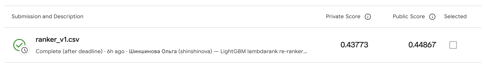

# Repeat Viewing Is the Signal: Co-view PageRank, Implicit ALS and a LightGBM Re-ranker for sweet.tv Programme Recommendation

**Student:** Olga Shinshinova  **Team:** Individual
**Email:** odshinshinova@edu.hse.ru  **Date:** 2026-10-25
**Assignment:** Final Exam Quiz (AVITO) — TV Program Recommendation on sweet.tv
**Code and submission files:** https://github.com/Shnshnva/midterm_quiz

---

## Abstract

For each of 1,260 sweet.tv users the task is to rank the five programmes they will watch most often, to at least 80% of an airing, in weeks 31–42, from a view log that only becomes user–programme data after an interval join with a schedule where 11.1% of airings carry a programme id. I implemented Personalized PageRank (PPR) on a programme co-view graph and implicit-feedback ALS, compared them with a popularity baseline on one temporal hold-out (history weeks 11–20, target 21–30), and combined them with a habit-based heuristic in a LightGBM lambdarank re-ranker. The re-ranker reaches hold-out MAP@5 0.3537 against 0.3232 for PPR, 0.3029 for ALS and 0.2138 for popularity, and a returned Kaggle private score of 0.43773. Only half (50.8%) of the programmes in users' future top-5 were already watched to the end in their history, yet every method — the final one included — fills about 90% of its list with such repeats, so the open problem is the other half.

*Index Terms* — personalized PageRank, implicit feedback, matrix factorization, learning to rank, TV recommendation

---

## 1. Introduction

**Problem.** The competition [8] supplies a view log (`dataset11-30.csv`, 5,821,987 channel-viewing intervals of 4,914 users, weeks 11–30 of 2020) and three broadcast schedules (weeks 11–20, 21–30, 31–42). The Data page defines the target precisely: drop `tv_show_id = 0` rows, compute for every user and airing the share of the airing the user watched, keep airings with share ≥ 0.8, count them per programme, and take *strictly* the five most frequent programmes, ordered. Scoring is MAP@5 with denominator min(5, |R_u|); public and private test sets are split by users (50/50), not by time.

**Motivation.** The label is a *frequency of repeated full viewing*, not a single new interaction. A method that is good at finding similar programmes is therefore not automatically good here, and the comparison the exam asks for — what PageRank diffusion, latent factors and a popularity list each capture — has a concrete answer that can be measured.

**Concrete example.** A heavy viewer (user …2829, 232 full watches of 97 programmes in weeks 11–20) watched *Факты* 37 times and the cartoon *Свинка Пеппа* 37 times. Their actual top-5 in weeks 21–30 is *Факты*, *Вспыш и чудо-машинки*, *Свинка Пеппа*, *Завтрак с 1+1*, *ТСН* — three of the five are their own top-3 from history. Popularity places two of these, PPR and ALS four (§5).

**Contributions.** (i) An interval join with merged views and the organisers' target rule, checked against hand-made fixtures, and one hold-out on which all methods are compared with paired bootstrap intervals. (ii) Evidence that, on this target, the gain of the hybrid over PPR (+0.030 MAP@5, 95% CI [0.027, 0.034]) comes from re-ordering repeats and from a schedule-slot habit feature, while no method recovers the target programmes the user has not fully watched before.

## 2. Related Work

[1] Y. Hu, Y. Koren, and C. Volinsky, "Collaborative filtering for implicit feedback datasets," in *Proc. 8th IEEE Int. Conf. Data Mining (ICDM)*, 2008, pp. 263–272, doi: 10.1109/ICDM.2008.22.

[2] L. Page, S. Brin, R. Motwani, and T. Winograd, "The PageRank citation ranking: Bringing order to the Web," Stanford InfoLab, Tech. Rep. 1999-66, 1999. [Online]. Available: http://ilpubs.stanford.edu:8090/422/

[3] T. H. Haveliwala, "Topic-sensitive PageRank," in *Proc. 11th Int. Conf. World Wide Web (WWW)*, 2002, pp. 517–526, doi: 10.1145/511446.511513.

[4] G. Ke *et al.*, "LightGBM: A highly efficient gradient boosting decision tree," in *Advances in Neural Information Processing Systems 30 (NIPS)*, 2017. [Online]. Available: https://papers.nips.cc/paper_files/paper/2017/hash/6449f44a102fde848669bdd9eb6b76fa-Abstract.html

[5] C. J. C. Burges, "From RankNet to LambdaRank to LambdaMART: An overview," Microsoft Research, Tech. Rep. MSR-TR-2010-82, 2010. [Online]. Available: https://www.microsoft.com/en-us/research/wp-content/uploads/2016/02/MSR-TR-2010-82.pdf

[6] G. V. Cormack, C. L. A. Clarke, and S. Buettcher, "Reciprocal rank fusion outperforms Condorcet and individual rank learning methods," in *Proc. 32nd ACM SIGIR*, 2009, pp. 758–759, doi: 10.1145/1571941.1572114.

[7] Marrrik, "sweettv-recsys: sweet.tv TV programme recommender (RecSys final exam, GSB HSE)," GitHub repository, 2026. [Online]. Available: https://github.com/Marrrik/sweettv-recsys [Accessed: 2026-10-23].

Hu *et al.* [1] give the confidence-weighted ALS used for the MF method; implicit counts are confidence, not ratings, which fits "number of fully watched airings". PageRank [2] with a non-uniform teleport vector [3] is the PPR method, with the teleport set to one user's history. The re-ranker is gradient-boosted trees [4] trained with the LambdaRank objective [5]; the untrained fusion is weighted reciprocal rank fusion [6]. A solution of the same exam by the GSB cohort [7] was published two days before this deadline; I read its README, result tables and `target.py`/`baselines.py`. From it I took (a) confirmation that the 0.8 rule on the Data page is the target rule, which I then read on the Data page myself, and (b) the idea of scaling a user's habit by the number of airings in the target window ("habit × schedule"). No code was copied; my join, PPR, ALS wrapper, features and re-ranker were written in this session (§6). Its reported Kaggle private scores (PPR 0.39635, ALS 0.36427, re-ranker 0.45015) are used only as an external reference point.

**Alternatives considered.** *Content-based filtering*: not implemented as a method because the target separates programmes of the same category and genre by how often a user returns to them (*ТСН* vs *Факты*, both "Инфо"); [7] reports private 0.0895 for a TF-IDF profile. *Association rules*: implemented by [7] at 0.34068 private, below its PPR and ALS; dropped for time. *Two-tower / sequential models*: no item text beyond titles and only 20 training weeks, so not attempted.

## 3. Method

**Pipeline.**
`raw CSV → parquet (01) → probes (02) → interval join + target (03) → snapshot (history, pool) → base methods → candidates + features → LightGBM lambdarank → top-5 + popularity fill → submission (06/08)`

**Join rule.** Overlapping views of one user on one channel are first merged into a union of intervals (5,821,987 views → 5,441,773 segments), so no second counts twice. A segment matches every airing on the same channel (`vsetv_id = channel_id`) whose interval overlaps it; covered seconds are summed per (user, airing) and divided by the airing's `duration`. Before joining I checked the clocks: shifting the schedule by −3…+3 h, the share of view starts within 2 min of an airing start is highest at 0 h (7.25% vs 6.40–7.03%), so no shift is applied.

**Threshold.** An airing counts as watched at share ≥ 0.8. The observed share is far from that: over 3,014,129 labelled (user, airing) pairs the median share is 0.195, the 75th percentile 0.657 and the 90th 1.0, i.e. most overlaps are channel-surfing. I used 0.8 not because of this distribution but because it is the organisers' definition of the label (§1): using the same quantity for history and target makes "habit" and "label" one variable. 611,760 pairs (20.3%) pass it.

**`tv_show_id = 0`.** These 88.9% of airings are never items. They do enter two features as *watching context*: channel share of a user's total viewing seconds, and the slot habit below.

**Validation split.** History weeks 11–20, target weeks 21–30; every model and feature sees only weeks 11–20. 4,030 users have a strict top-5 in weeks 21–30 and are evaluated; 1,150 of them are test users, reported separately. The submission snapshot uses history weeks 11–30 and the schedule of weeks 31–42 only to know what airs when.

**Candidate pool and repeats.** Programmes with at least one labelled airing in the target window (6,376 on the hold-out, 6,642 in weeks 31–42). Recommending already-watched programmes is allowed for every method — the target is built from repeats.

**From scores to five ids.** Every method returns a users × programmes score matrix; outside the pool scores are −∞. The five highest positive scores are taken in order; empty positions are filled from one popularity ranking (pool programmes by number of distinct users with a full watch in history, ties by window airings). The same ranking is the answer for users without history (4 of 1,260 test users; 59 of 4,030 hold-out users).

**Methods.** Interaction matrix R: users × programmes, R_ui = number of airings of programme i watched ≥ 0.8 in history.
- *Popularity* (baseline): the fill ranking above, same list for everyone.
- *Habit × schedule* (heuristic, not one of the four methods): R_ui / (airings of i in history + 100) × airings of i in the target window — the expected number of full watches if the user keeps their rate.
- *PPR*: item-to-item transitions P = D_i⁻¹ Rᵀ D_u⁻¹ R (programme → viewer → programme); for each user x = α s + (1 − α) x P with s = R_u / |R_u|, α = 0.5, 30 power iterations, all users at once as a dense 4,870 × 7,146 matrix.
- *ALS* [1]: `implicit` 0.7.3, confidence 0.5·log(1 + R_ui), 128 factors, regularisation 5, 20 iterations, seed 0; score = p_uᵀ q_i.
- *Rank fusion* [6]: Σ w_m / (20 + rank_m + 1) over the top-50 of habit × schedule (w = 2), PPR (1), ALS (0.5).
- *Re-ranker (final)*: candidates = union of top-80 pool programmes of habit, habit × schedule, PPR and ALS plus 30 most popular (≈110 per user). 23 features: the four scores and their ranks; popularity; airings in history and in the window; weeks since last full watch; full watches in the last 2 weeks; partial-watch seconds and airings touched; user's total full watches and programme count; habit share; share of the user's viewing seconds on the programme's main channel; and *slot habit* — the user's weekly viewing seconds in each (channel, weekday, hour) slot, over all airtime, summed over the slots where the programme airs in the window, for the whole history and the last 4 weeks, plus both divided by window airings. Label = 5…1 for target ranks #1…#5, 0 otherwise. LightGBM [4] `lambdarank` [5], 300 rounds, learning rate 0.05, 63 leaves, min 50 samples per leaf, feature and bagging fraction 0.8, L2 1.0, mean of seeds 0–2. Training snapshots for the hold-out score: cutoffs at weeks 14 and 16 (history 11–13 / 11–15, targets to week 20), so no hold-out label is seen. For the submission the cutoffs 21 and 24 (targets to week 30) are added.

**Key design decisions.** (1) Merge views before the join; in the fixture of `tests/test_core.py` two overlapping views would give 70 + 40 = 110 s of a 90 s airing without it; merged, 90 s. (2) Keep repeats and restrict to the window pool, identical across methods. (3) Use unlabelled airtime only as context, which is what lets the slot habit score programmes a user has never watched.

**Environment.** Apple M5, 10 cores, 24 GB, macOS (Darwin 25.5); Python 3.12.15 with uv; numpy 2.5.4, pandas 3.1.0, scipy 1.18.1, pyarrow 26.0.0, implicit 0.7.3, lightgbm 4.7.0. Run order and seeds are in the repository README; `submissions/ranker_v1.csv` is regenerated byte-for-byte by `scripts/08_ranker.py submit`.

## 4. Experiments

| Quantity | Value | Source |
|---|---|---|
| Views / users in log | 5,821,987 / 4,914 | `artifacts/join_stats.json` |
| Schedule airings (deduplicated) / labelled | 3,444,006 / 381,892 (11.1%) | same |
| Weeks 11–20 file: labelled rows | 115,613 of 1,074,235 (10.8%) | build log |
| (user, airing) pairs / with share ≥ 0.8 | 3,014,129 / 611,760 | same |
| Hold-out: users, items, pool | 4,870, 7,146, 6,376 | `validation.json` |
| Hold-out: evaluated users (strict top-5 in 21–30) / of them test users | 4,030 / 1,150 | same |
| Test users in log / without full-watch history in 11–30 | 1,260 / 4 | `submission_accounting.json` |

*Table 1. Data accounting.*

| Method | Hold-out MAP@5 (4,030) | Test users (1,150) | AP = 0 share | Kaggle public | Kaggle private | Runtime* |
|---|---|---|---|---|---|---|
| Popularity (baseline) | 0.2138 | 0.2357 | 26.3% | 0.30258 | 0.29969 | 0.1 s |
| Habit × schedule | 0.3308 | 0.3682 | 15.0% | — | — | 0.1 s |
| **PPR** (α 0.5) | 0.3232 | 0.3590 | 14.5% | 0.41947 | 0.40882 | 8 s |
| **ALS** (128, reg 5, α 0.5) | 0.3029 | 0.3308 | 16.2% | 0.39486 | 0.38450 | 1.7 s |
| Rank fusion | 0.3340 | 0.3706 | 15.0% | 0.42654 | 0.41555 | sum of parts |
| **Re-ranker (final)** | **0.3537** | **0.3909** | **12.3%** | **0.44867** | **0.43773** | 49 s / 91 s |

*Table 2. One hold-out, one pool, one fill rule. \*Hold-out scoring time; re-ranker: hold-out run incl. features of three snapshots / final train + predict. Habit × schedule was not submitted.*

**Comparison vs baseline.** Every personalised method beats popularity by a wide margin (ALS − popularity +0.089, 95% CI [0.084, 0.095], paired bootstrap over users, 2,000 resamples). PPR beats ALS (+0.020 [0.017, 0.023]) and the re-ranker beats PPR (+0.030 [0.027, 0.034]) and the fusion (+0.020 [0.017, 0.022]). The order of methods on the hold-out is the order on Kaggle. Kaggle scores are higher; the test window (12 weeks) and history (20 weeks) are both longer than on the hold-out (10 and 10), which is a likely but untested reason.

| Programmes in history | Users | Popularity | PPR | ALS | Re-ranker |
|---|---|---|---|---|---|
| 0 | 59 | 0.142 | 0.142 | 0.142 | 0.155 |
| 1–2 | 61 | 0.111 | 0.120 | 0.105 | 0.135 |
| 3–10 | 586 | 0.131 | 0.188 | 0.181 | 0.214 |
| 11–30 | 2,000 | 0.204 | 0.316 | 0.298 | 0.346 |
| > 30 | 1,324 | 0.273 | 0.411 | 0.380 | 0.446 |

*Table 3. Hold-out MAP@5 by number of fully watched programmes in weeks 11–20.*

| Step | Change (one at a time) | MAP@5 | Kept |
|---|---|---|---|
| R1 | LightGBM over top-30 candidates | 0.3481 | yes |
| R2 | top-80 + 30 popular (candidate recall 0.62 → 0.72) | 0.3483 | yes |
| R3 | + slot-habit features | **0.3537** | **final** |
| R4–R9 | more cutoffs; + binary objective; recency decay; PPR α 0.3/0.85; slower GBM; active-day exposure | 0.3524–0.3532 | no |

*Table 4. Re-ranker ablation (full list in `artifacts/ranker_experiments.md`).*

**Verification.**
- Unit tests (`tests/test_core.py`, 4 passed): AP@5 reproduces the lecture example (0.917 and 0.533); a duplicate in the list scores once; overlapping views are merged (90 s, not 110 s); the 0.8 threshold and the strict-top-5 rule.
- Byte-level reproducibility: rebuilding each submitted file gives an identical file (`cmp`), including ALS with seed 0 and the final re-ranker.
- [OLGA: hand check 1 — the partial-coverage airing in `artifacts/hand_check.md` (channel 7, 2020-03-09 16:40–19:00, two views). Write your own subtraction here: overlap of view 1 = …, view 2 = …, sum = … s, ÷ 8,400 = …; code: 7,223 s, 0.8599. Optionally confirm the rows with `grep` in the raw CSVs.]
- [OLGA: hand check 2 — AP@5 of the re-ranker for user …5641: actual [240081, 2400480, 10003012, 2400467, 10002515], predicted [2400480, 240081, 90080832, 10001261, 2400508] → your computation; code: 0.400000.]

## 5. Discussion

### 5.1 Two users and the strategy question

I chose the two users by a rule fixed before looking at lists: among test users with a hold-out target, the *heavy* user is the one closest to the 95th percentile of history full watches; the *light* user is the first by id with 1–2 programmes in history.

| id | title | category | | id | title | category |
|---|---|---|---|---|---|---|
| 240081 | Факты | Инфо | | 90044148 | Х/ф 'Волга-Волга' | Фильмы |
| 2400480 | ТСН | Инфо | | 90055479 | Х/ф 'SWAT: Спецназ города ангелов' | Фильмы |
| 2400467 | Викна-Новости | Инфо | | 90077217 | Х/ф 'Геракл: Начало легенды' | Фильмы |
| 2400508 | Сегодня | Инфо | | 90080832 | Х/ф 'Безбашенные' | Фильмы |
| 200344 | Чистоnews | Развлечения | | 90081097 | Х/ф 'Уцелевшая' | Фильмы |
| 20088 | Завтрак с 1+1 | Развлечения | | 90064639 | Х/ф 'Пророк' | Фильмы |
| 12002955 | М/с 'Свинка Пеппа' | Детям | | 10003012 | Т/с 'Однажды в Одессе' | Сериалы |
| 12002896 | М/с 'Вспыш и чудо-машинки' | Детям | | 10002515 | Т/с 'Мамочки' | Сериалы |
| 12002805 | М/с 'Моланг' | Детям | | 10001261 | Т/с 'Мыслить как преступник' | Сериалы |
| 12001682 | М/с 'Губка Боб' | Детям | | | | |

*Table 5. Legend for Table 6 (title and category looked up from the schedule).*

| | Heavy user …2829 (232 full watches, 97 programmes) | AP@5 | Light user …5641 (2 full watches, 2 films) | AP@5 |
|---|---|---|---|---|
| History top | 12002955 (37), 240081 (37), 12002896 (30), 12002805 (6), 2400467 (5) | | 90044148 (1), 90055479 (1) | |
| **Actual 21–30** | 240081, 12002896, 12002955, 20088, 2400480 | | 240081, 2400480, 10003012, 2400467, 10002515 | |
| Popularity | **2400480**, **240081**, 2400467, 200344, 2400508 | 0.40 | **2400480**, **240081**, **2400467**, 200344, 2400508 | 0.60 |
| Habit × schedule | **12002955**, **240081**, **12002896**, 12002805, 2400467 | 0.60 | 90055479, 90044148, **2400480**, **240081**, **2400467** | 0.29 |
| PPR | **240081**, **12002955**, **12002896**, **2400480**, 12001682 | 0.80 | 90055479, 90044148, **2400480**, **240081**, 12001682 | 0.17 |
| ALS | **240081**, **12002955**, **2400480**, **12002896**, 12002805 | 0.80 | 90077217, 90080832, 90081097, 90064639, 90055479 | 0.00 |
| Re-ranker | **240081**, **12002955**, **12002896**, **2400480**, 12002805 | 0.80 | **2400480**, **240081**, 90080832, 10001261, 2400508 | 0.40 |

*Table 6. Hold-out top-5 per method, in order; bold = in the user's actual top-5 for weeks 21–30.*

[OLGA: rewrite 5.1–5.3 in your own words; the points below are the evidence to use.]

**Familiar or new?** For the heavy user every personal list is familiar: PPR and ALS return four of the five actual programmes, all already in the history, and miss only *Завтрак с 1+1*, which the user never fully watched in weeks 11–20. Across all hold-out users only 50.8% of actual top-5 programmes were fully watched in history, yet the lists are 84% (re-ranker) to 96% (habit × schedule) repeats; the final submission is 90% repeats and uses only 123 distinct programmes for 1,260 users. The methods are reliable at the familiar half and do not reach the new half.

**How the methods differ.** PPR with α = 0.5 restarts at the user's history every second step, so it is a smoothed copy of the history plus programmes reached through the co-view graph — for the heavy user it adds *ТСН*, not in their history top-5, at rank 4, and it is in the actual top-5. ALS spreads the user vector over the latent space: for the light user, whose history is two one-off films, it returns five other films (AP 0.00) — similar, but this user's future is news and series. Habit × schedule and PPR put the two films first because they were fully watched, although a film airs once and cannot become a frequent programme. Popularity, a list of national news, is the best of all methods for this user (0.60), but Table 3 shows this is not typical of light users: for users with 1–2 programmes popularity averages 0.111 and the re-ranker 0.135. The re-ranker demoted both films (few window airings, one watch) and put the news first.

**Why the re-ranker.** It is the best on the hold-out overall (+0.030 over PPR, CI excludes 0) and in every history segment of Table 3, and on Kaggle (0.43773 private). Cost is modest at this scale: the hold-out run, including features for three snapshots and three seeds, takes 49 s and the final run 91 s on a laptop CPU; PPR as a dense 7,146 × 7,146 transition matrix would not scale to a catalogue 10× larger without sparse iteration. For the user it means a list built mostly from programmes they already return to, ordered by how often they will air in their usual slots.

**Limitations.** Only 11.1% of airings carry an id, so most viewing is invisible as items; users whose viewing is mostly unlabelled are effectively cold (59 hold-out users without history score 0.142–0.155 with any method). Absence of a programme from the log means only that it was not watched on this platform. The hold-out has 10 target weeks and 10 history weeks while the test has 12 and 20, so hold-out numbers are not Kaggle numbers. The fusion weights and all hyper-parameters were chosen on the same hold-out that reports them, so those hold-out values are optimistic; Kaggle scores are the out-of-sample check. Nothing here shows whether a recommended programme was enjoyed.

### 5.2 Failure case: a submission the code no longer reproduced

**Detection.** After testing R5 (a blend of lambdarank and binary objectives) and reverting to lambdarank only, rebuilding the final file gave a file different from the one submitted as `ranker_v1.csv`, although the hold-out score was again 0.3537: 7 of 1,260 users differed, 12 of 6,300 positions, mostly two near-tied programmes swapped.
**Root cause.** Two reruns of the new code were identical to each other, so training was deterministic; the difference was code. R5 had added per-model standardisation of predictions (needed to average log-odds with lambdarank scores) and it stayed after R5 was removed. Averaging three standardised seeds orders near-ties differently from averaging raw scores.
**Fix and confirmation.** I restored the plain mean; `cmp` then reported the rebuilt file identical to the submitted one, and the hold-out stayed 0.3537. Without this, the repository would contain code that does not produce the reported Kaggle score.

### 5.3 What worked, what did not, next

*Worked:* the frequency label used directly as the interaction value; the slot habit (+0.005, the third feature by gain), the only feature that uses the 88.9% unlabelled airtime; checking the clock alignment before the join.
*Surprised / did not work:* ALS lost to simply repeating the user's own history (0.3029 vs 0.3076 on the hold-out); a larger candidate set raised candidate recall from 0.62 to 0.72 but MAP@5 by only 0.0002, so ordering, not recall, is the bottleneck; six further re-ranker variants (R4–R9) all landed within 0.001 of each other.
*Next:* model the non-repeat half explicitly — a separate candidate source for programmes that start airing in the target window in slots the user already watches, evaluated on the non-repeat part of the target.

## 6. AI Usage Disclosure

**Tools.** Claude Code (CLI) with model Claude Opus 5.5 (`claude-opus-5-5`), one session; the attached JSONL is its unmodified export. [OLGA: add message / tool-call counts from the export.]

**How AI was used.** *Search:* found the GSB-cohort repository [7] and verified reference metadata (Crossref, publisher pages). *Code generation:* all files in `src/` and `scripts/`, the tests, and this report draft. *Debugging:* the reproducibility failure in §5.2, ruff/ty fixes. *Analysis:* bootstrap intervals, segment table, user selection rule. I directed the scope (two required methods first, then the hybrid with a 2-hour limit), accepted the Kaggle rules, supplied the Data-page text, and chose when to stop tuning.

**What I personally verified.** [OLGA: list only what you actually did, e.g. (1) recomputed the partial-coverage airing by hand: …; (2) recomputed AP@5 = 0.4 for user …5641: …; (3) checked that the Kaggle scores in Table 2 match my Submissions page (screenshot below); (4) opened each reference link.]

**What I trusted without verification.** [OLGA: e.g. the PPR and ALS implementations beyond the unit tests; the bootstrap code; the scores reported by [7]; the other counts in Table 1.]

**Kaggle.** Designated final submission: `submissions/ranker_v1.csv`, ref 57621475, returned private 0.43773 / public 0.44867. The competition closed in 2020, so the *Selected* box cannot be ticked for a late submission; the designation is made here. All submissions and their scores are in `artifacts/kaggle_submissions.csv`.

<figure><figcaption>Fig. 1. Kaggle Submissions page, final submission row (screenshot 2026-10-25).</figcaption></figure>

## References

[1]–[7] as in §2.

[8] ogurbych, "sweet.tv — TV program recommender," Kaggle community competition, 2020. [Online]. Available: https://www.kaggle.com/competitions/sweettv-tv-program-recommender [Accessed: 2026-10-25].

[9] B. Frederickson, "implicit: Fast Python collaborative filtering for implicit feedback datasets," GitHub repository. [Online]. Available: https://github.com/benfred/implicit [Accessed: 2026-10-25].
